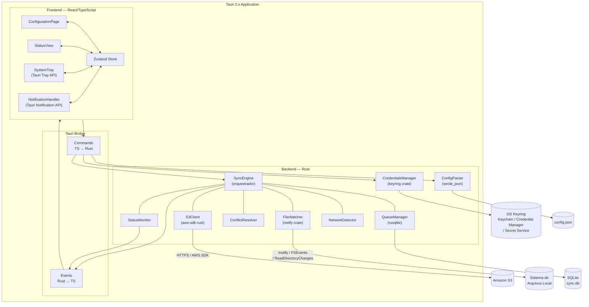
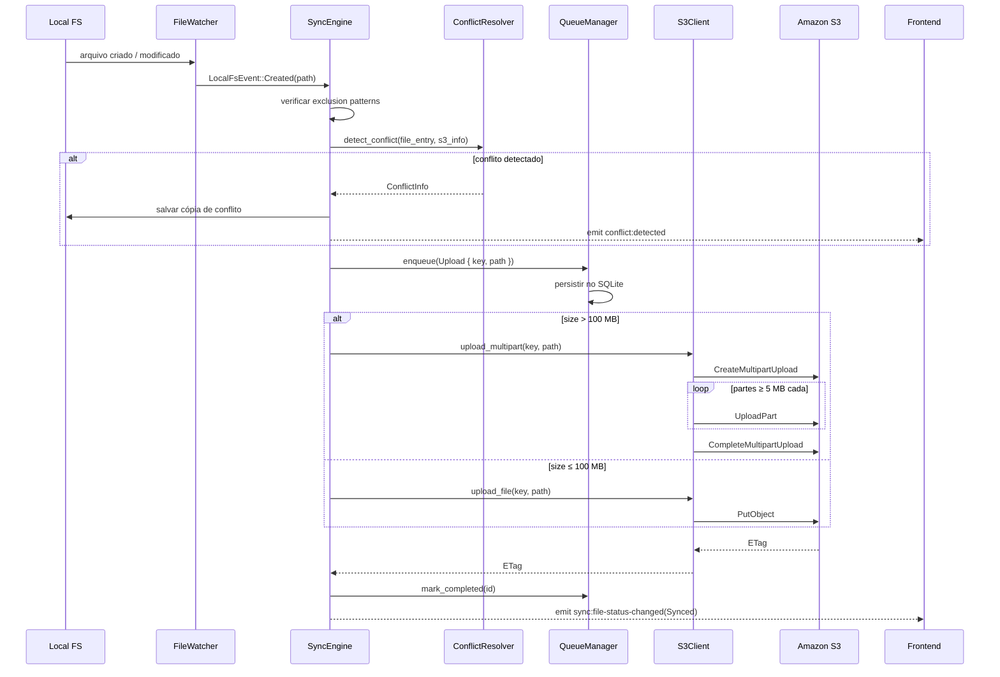
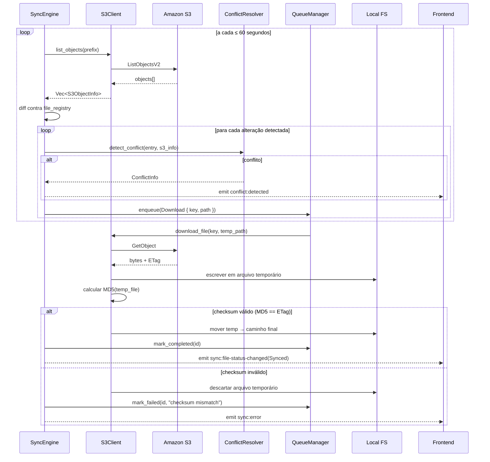

# Design Document: Amazon S3 Drive

## Reconciliação persistida de exclusões

`SyncEngine::poll_remote_changes` compara `file_registry`, arquivos locais e a listagem remota. Arquivos conhecidos ausentes de um lado geram `DeletionReview` em `deletion_reviews` (tabela aditiva criada também em bancos existentes). ETag remoto e hash local representam a revisão exibida. As operações normais da fila e a varredura local não devem sobrescrever arquivos em revisão. Objetos desconhecidos no S3 continuam sendo baixados; prefixos S3 são removidos ao mapear o caminho local.

`get_deletion_reviews` retorna pendências persistidas à interface, consultadas a cada dois segundos por `DeletionReviewPanel`. `resolve_deletion(review, restore)` recebe a revisão completa exibida, compara-a com a persistida e revalida os conteúdos. Um mutex serializa decisões e polling. Alterações concorrentes invalidam a decisão; a exclusão remota usa `If-Match` com o ETag aprovado.

Restaurar significa baixar se o lado excluído é local ou enviar se o lado excluído é remoto. Confirmar significa copiar o objeto remoto para `<prefixo>/.s3-drive-trash/<timestamp>/<chave>` antes de apagar, ou mover o arquivo local para `<pasta>/.s3-drive-trash/<timestamp>/<nome>`. Cópias internas não entram na sincronização. Falhas de cópia impedem a remoção; não há coleta automática dessas cópias nem interface de recuperação nesta etapa. O backend exige permissão de cópia/leitura e gravação no prefixo de recuperação. A troca de identidade da configuração limpa as pendências junto com o restante do estado.

Uma pasta raiz previamente sincronizada indisponível bloqueia o início em vez de ser recriada vazia. DownloadOnly restaura ausências locais e preserva uma cópia local antes de aplicar exclusões remotas; UploadOnly não infere exclusões locais feitas com o app fechado.

## Overview

O Amazon S3 Drive é uma aplicação desktop cross-platform construída com **Tauri 2.x** (Rust + React/TypeScript). O aplicativo cria um drive virtual que sincroniza arquivos bidirecionalmente entre uma pasta local no computador do usuário e um bucket Amazon S3, operando em segundo plano via system tray.

**Princípios de design:**
- Backend Rust cuida de toda a lógica pesada: sincronização, monitoramento de arquivos, comunicação com S3, fila de operações e resolução de conflitos
- Frontend React/TypeScript é responsável exclusivamente pela interface: configuração, system tray, notificações e exibição de status
- Comunicação entre as camadas ocorre exclusivamente via Tauri Commands (TypeScript → Rust) e Tauri Events (Rust → TypeScript)
- A pasta local é uma pasta real sincronizada, não um sistema de arquivos virtual montado (sem FUSE/driver de kernel)
- A fila de operações é persistida em SQLite para garantir durabilidade entre reinicializações

---

## Architecture

### Diagrama de Componentes



### Fluxo de Upload



### Fluxo de Download



### Decisões Arquiteturais

| Decisão | Alternativas consideradas | Justificativa |
|---|---|---|
| Pasta real (sem FUSE) | FUSE driver, Dokan (Windows) | Sem driver de kernel, instalação simples, cross-platform nativo |
| SQLite para fila offline | Redis, arquivo JSON, memória | Persistência durável entre reinicializações, operações atômicas, sem servidor externo |
| Polling S3 (≤ 60s) | S3 Event Notifications + SQS/SNS | Sem infraestrutura extra; latência de 60s atende o Requisito 3.4 |
| Tauri 2.x | Electron, Flutter | Bundle menor, performance Rust, APIs nativas via plugins oficiais |
| `notify` crate | polling manual, inotify direto | Abstração cross-platform: inotify (Linux), FSEvents (macOS), ReadDirectoryChanges (Windows) |
| Debounce de 2s em modificações | sem debounce | Evita múltiplos uploads de arquivo sendo escrito incrementalmente |

---

## Components and Interfaces

### SyncEngine

Orquestrador central. Coordena todos os outros componentes do backend via canais assíncronos (`tokio::mpsc`).

```rust
pub struct SyncEngine {
    config: Arc<RwLock<AppConfig>>,
    s3_client: Arc<S3Client>,
    file_watcher: FileWatcher,
    queue_manager: Arc<QueueManager>,
    conflict_resolver: ConflictResolver,
    status_monitor: Arc<StatusMonitor>,
    network_detector: NetworkDetector,
    app_handle: tauri::AppHandle,
}

impl SyncEngine {
    pub async fn start(&self) -> Result<(), SyncError>;
    pub async fn stop(&self) -> Result<(), SyncError>;
    pub async fn process_local_event(&self, event: LocalFsEvent) -> Result<(), SyncError>;
    pub async fn poll_remote_changes(&self) -> Result<(), SyncError>;
    pub async fn process_queue(&self) -> Result<(), SyncError>;
    pub fn reload_config(&self, config: AppConfig);
}
```

### FileWatcher

Wraps a crate `notify`. Converte eventos raw do sistema operacional em `LocalFsEvent` tipado. Aplica debounce de 2 segundos para eventos de modificação.

```rust
pub struct FileWatcher {
    watcher: notify::RecommendedWatcher,
    event_tx: mpsc::Sender<LocalFsEvent>,
}

pub enum LocalFsEvent {
    Created(PathBuf),
    Modified(PathBuf),
    Deleted(PathBuf),
    Renamed { from: PathBuf, to: PathBuf },
}

impl FileWatcher {
    pub fn new(watch_path: PathBuf, tx: mpsc::Sender<LocalFsEvent>) -> Result<Self, WatchError>;
    pub fn start(&mut self) -> Result<(), WatchError>;
    pub fn stop(&mut self);
    pub fn update_path(&mut self, new_path: PathBuf) -> Result<(), WatchError>;
}
```

### S3Client

Wraps `aws-sdk-rust`. Abstrai todas as chamadas à API S3, incluindo multipart upload e retomada de transferências.

```rust
pub struct S3Client {
    inner: aws_sdk_s3::Client,
    bucket: String,
}

impl S3Client {
    pub async fn list_objects(&self, prefix: Option<&str>) -> Result<Vec<S3ObjectInfo>, S3Error>;
    pub async fn upload_file(&self, key: &str, path: &Path) -> Result<String, S3Error>; // → ETag
    pub async fn upload_multipart(
        &self, key: &str, path: &Path,
        resume: Option<MultipartState>,
    ) -> Result<String, S3Error>;
    pub async fn download_file(&self, key: &str, dest: &Path) -> Result<String, S3Error>; // → ETag
    pub async fn delete_object(&self, key: &str) -> Result<(), S3Error>;
    pub async fn copy_object(&self, src: &str, dst: &str) -> Result<(), S3Error>;
    pub async fn head_object(&self, key: &str) -> Result<S3ObjectInfo, S3Error>;
    pub async fn test_access(&self) -> Result<(), S3Error>;

    /// Determina se o arquivo requer multipart (tamanho > 100 MB)
    pub fn requires_multipart(file_size: u64) -> bool;

    /// Calcula as partes para multipart upload (todas ≥ 5 MB, exceto a última)
    pub fn compute_parts(file_size: u64, part_size: u64) -> Vec<PartRange>;
}
```

Lógica de multipart upload:
- Tamanho mínimo de parte: **5 MB** (exigência da API S3), exceto última parte
- Tamanho padrão de parte: **8 MB**
- Estado de retomada (UploadId + partes concluídas) salvo no SQLite por até **24 horas**

### CredentialsManager

```rust
pub struct CredentialsManager {
    service: &'static str, // "amazon-s3-drive"
}

impl CredentialsManager {
    pub fn store(&self, creds: &AwsCredentials) -> Result<(), CredError>;
    pub fn load(&self) -> Result<Option<AwsCredentials>, CredError>;
    pub fn delete(&self) -> Result<(), CredError>;
    /// Valida o formato dos campos sem chamar a API AWS
    pub fn validate_format(creds: &AwsCredentials) -> Result<(), Vec<ValidationError>>;
    /// Verifica acesso ao bucket realizando uma chamada de teste à API S3
    pub async fn verify_access(&self, s3_client: &S3Client) -> Result<(), CredError>;
}
```

Regras de validação de formato (Requisito 4.1):
- `access_key_id`: exatamente 20 caracteres, apenas maiúsculas e dígitos — `[A-Z0-9]{20}`
- `secret_access_key`: exatamente 40 caracteres
- `region`: padrão `^[a-z]{2}-[a-z]+-\d$` (ex: `us-east-1`, `sa-east-1`)

### QueueManager

Fila persistente em SQLite. Garantia de ordem FIFO por `created_at`.

```rust
pub struct QueueManager {
    conn: Arc<Mutex<rusqlite::Connection>>,
}

pub const QUEUE_MAX_SIZE: usize = 10_000;

impl QueueManager {
    /// Enfileira operação. Retorna None se a fila estiver cheia.
    pub fn enqueue(&self, op: SyncOperation) -> Result<Option<i64>, QueueError>;
    /// Retorna o próximo item pendente em ordem cronológica.
    pub fn dequeue_next(&self) -> Result<Option<QueueItem>, QueueError>;
    pub fn mark_completed(&self, id: i64) -> Result<(), QueueError>;
    pub fn mark_failed(&self, id: i64, error: &str) -> Result<(), QueueError>;
    pub fn count_pending(&self) -> Result<usize, QueueError>;
    pub fn is_full(&self) -> Result<bool, QueueError>;
    pub fn get_all_pending_ordered(&self) -> Result<Vec<QueueItem>, QueueError>;
}
```

### ConflictResolver

```rust
pub struct ConflictResolver {
    local_base: PathBuf,
}

impl ConflictResolver {
    /// Detecta conflito: local_modified_time ≠ last_sync_time E s3_etag ≠ last_sync_etag
    pub fn detect_conflict(file: &FileEntry, s3: &S3ObjectInfo) -> bool;

    /// Gera o caminho de cópia de conflito:
    /// [nome_base](conflito-AAAA-MM-DD-HH-MM-SS).[extensão]
    pub fn conflict_path(original: &Path, timestamp: &DateTime<Utc>) -> PathBuf;

    pub async fn resolve(
        &self,
        file: &FileEntry,
        s3: &S3ObjectInfo,
        s3_client: &S3Client,
    ) -> Result<ConflictInfo, ConflictError>;
}
```

Condição de conflito (Requisito 6.4):
```
local_modified_time ≠ last_sync_time  AND  s3_etag ≠ last_sync_etag
```

Exemplo de nome de cópia de conflito:
- Original: `relatorio.docx`
- Conflito:  `relatorio(conflito-2024-01-15-14-30-00).docx`

### ConfigParser

```rust
pub struct ConfigParser {
    path: PathBuf,
}

impl ConfigParser {
    pub fn load(&self) -> Result<AppConfig, ConfigError>;
    pub fn save(&self, config: &AppConfig) -> Result<(), ConfigError>;
    pub fn create_empty(&self) -> Result<(), ConfigError>;
    pub fn validate(config: &AppConfig) -> Result<(), Vec<ValidationError>>;
}
```

Localização do arquivo de configuração (via `dirs::config_dir()`):
- **Windows**: `%APPDATA%\amazon-s3-drive\config.json`
- **macOS**: `~/Library/Application Support/amazon-s3-drive/config.json`
- **Linux**: `~/.config/amazon-s3-drive/config.json`

### StatusMonitor

```rust
pub struct StatusMonitor {
    states: Arc<RwLock<HashMap<String, SyncState>>>,
    app_handle: tauri::AppHandle,
}

impl StatusMonitor {
    pub fn set_state(&self, key: &str, state: SyncState);
    pub fn get_all(&self) -> Vec<FileStatus>;
    /// Calcula o estado global seguindo a prioridade: Error > Syncing/Pending > UpToDate
    pub fn global_state(&self) -> GlobalSyncState;
}
```

### NetworkDetector

```rust
pub struct NetworkDetector {
    is_online: Arc<AtomicBool>,
}

impl NetworkDetector {
    /// Inicia loop em background: tenta conexão TCP ao endpoint S3 a cada 10s
    pub fn start(&self, s3_endpoint: &str);
    pub fn is_online(&self) -> bool;
    pub fn on_state_change(&self, callback: impl Fn(bool) + Send + 'static);
}
```

### Tauri Commands

Todas as funções invocáveis pelo frontend TypeScript:

```typescript
// Configuração
invoke<AppConfig>('get_config')
invoke<void>('save_config', { config: AppConfig })
invoke<ValidationError[]>('validate_config', { config: AppConfig })

// Credenciais
invoke<void>('save_credentials', { creds: AwsCredentials })
invoke<void>('test_connection')
invoke<void>('delete_credentials')

// Controle de Sync
invoke<void>('start_sync')
invoke<void>('stop_sync')
invoke<FileStatus[]>('get_sync_status')
invoke<GlobalSyncState>('get_global_state')

// Fila
invoke<QueueStats>('get_queue_stats')
```

### Tauri Events

Todos os eventos emitidos pelo backend Rust:

```typescript
// Status de arquivo
listen<FileStatusEvent>('sync:file-status-changed')
listen<SyncErrorEvent>('sync:error')
listen<{ files_synced: number }>('sync:initial-complete')

// Conflitos
listen<ConflictEvent>('conflict:detected')

// Conectividade e fila
listen<void>('network:offline')
listen<void>('network:online')
listen<void>('queue:full')

// Credenciais
listen<void>('credentials:expired')
listen<void>('credentials:invalid')
```

---

## Data Models

### Rust Structs

```rust
// === Configuração da Aplicação ===
#[derive(Debug, Clone, Serialize, Deserialize, PartialEq)]
pub struct AppConfig {
    pub bucket_name: String,
    pub local_path: String,
    pub s3_prefix: Option<String>,
    pub aws_region: String,
    pub sync_interval_secs: u64,          // padrão: 60
    pub exclusion_patterns: Vec<String>,   // glob patterns, ex: "*.tmp", ".DS_Store"
    pub notifications: NotificationSettings,
    pub use_iam_role: bool,
}

#[derive(Debug, Clone, Serialize, Deserialize, PartialEq)]
pub struct NotificationSettings {
    pub sync_complete_enabled: bool,
    pub conflict_enabled: bool,
    pub error_enabled: bool, // não pode ser desabilitado pela UI (Requisito 10.4)
}

// === Credenciais AWS (jamais serializado para arquivo em disco) ===
#[derive(Debug, Clone)]
pub struct AwsCredentials {
    pub access_key_id: String,
    pub secret_access_key: String,
    pub session_token: Option<String>,  // STS — Requisito 4.8
    pub region: String,
    pub use_iam_role: bool,             // IAM Role — Requisito 4.5
}

// === Estado de Sincronização por Arquivo ===
#[derive(Debug, Clone, Serialize, Deserialize, PartialEq)]
#[serde(tag = "type", content = "message")]
pub enum SyncState {
    Pending,
    Syncing,
    Synced,
    Error(String),
}

// === Registro de Arquivo (fonte da verdade para detecção de conflitos) ===
#[derive(Debug, Clone, Serialize, Deserialize)]
pub struct FileEntry {
    pub s3_key: String,
    pub local_path: String,
    pub sync_state: SyncState,
    pub last_sync_etag: Option<String>,
    pub last_sync_time: Option<DateTime<Utc>>,
    pub local_modified_time: Option<DateTime<Utc>>,
    pub size_bytes: u64,
}

// === Metadados de Objeto S3 ===
#[derive(Debug, Clone)]
pub struct S3ObjectInfo {
    pub key: String,
    pub etag: String,          // sem aspas, normalizado
    pub size: u64,
    pub last_modified: DateTime<Utc>,
}

// === Operação de Sincronização ===
#[derive(Debug, Clone, Serialize, Deserialize)]
pub enum SyncOperationType {
    Upload,
    Download,
    Delete,
    Rename,
    Move,
}

#[derive(Debug, Clone, Serialize, Deserialize)]
pub struct SyncOperation {
    pub operation_type: SyncOperationType,
    pub s3_key: String,
    pub local_path: String,
    pub extra: Option<String>, // caminho destino para Rename/Move
}

// === Item da Fila Persistida ===
#[derive(Debug, Clone, Serialize, Deserialize)]
pub struct QueueItem {
    pub id: i64,
    pub operation: SyncOperation,
    pub created_at: DateTime<Utc>,
    pub retry_count: u32,
    pub error_message: Option<String>,
}

// === Informações de Conflito ===
#[derive(Debug, Clone, Serialize, Deserialize)]
pub struct ConflictInfo {
    pub file_name: String,
    pub local_path: String,
    pub conflict_copy_path: String,
    /// Formato para notificação: "AAAA-MM-DD HH:MM:SS UTC"
    pub local_modified: DateTime<Utc>,
    pub remote_modified: DateTime<Utc>,
    pub local_size_bytes: u64,
    pub remote_size_bytes: u64,
}

// === Estado de Retomada de Multipart Upload ===
#[derive(Debug, Clone, Serialize, Deserialize)]
pub struct MultipartState {
    pub s3_key: String,
    pub upload_id: String,
    pub local_path: String,
    pub created_at: DateTime<Utc>,
    pub completed_parts: Vec<CompletedPart>,
}

#[derive(Debug, Clone, Serialize, Deserialize)]
pub struct CompletedPart {
    pub part_number: i32,
    pub etag: String,
    pub byte_offset: u64,
    pub size: u64,
}

/// Intervalo de bytes para uma parte de multipart upload
#[derive(Debug, Clone, PartialEq)]
pub struct PartRange {
    pub part_number: i32,
    pub offset: u64,
    pub size: u64,
}

// === Estado Global de Sincronização ===
#[derive(Debug, Clone, Serialize, Deserialize, PartialEq)]
pub enum GlobalSyncState {
    UpToDate, // todos os arquivos com estado Synced
    Syncing,  // ao menos um Syncing ou Pending
    Error,    // ao menos um Error
    Offline,  // sem conectividade
}

// === Erros de Domínio ===
#[derive(Debug, thiserror::Error, Serialize)]
pub enum SyncError {
    #[error("S3 error: {0}")]
    S3(String),
    #[error("IO error: {0}")]
    Io(String),
    #[error("Queue full — cannot enqueue operation")]
    QueueFull,
    #[error("Checksum mismatch for {file}")]
    ChecksumMismatch { file: String },
    #[error("Max retries exceeded for {file}: {reason}")]
    MaxRetries { file: String, reason: String },
}

#[derive(Debug, Serialize)]
pub struct ValidationError {
    pub field: String,
    pub reason: String,
}
```

### Schema SQLite

```sql
-- Fila de operações pendentes de sincronização
CREATE TABLE IF NOT EXISTS sync_queue (
    id              INTEGER PRIMARY KEY AUTOINCREMENT,
    operation_type  TEXT NOT NULL CHECK (operation_type IN
                    ('Upload','Download','Delete','Rename','Move')),
    s3_key          TEXT NOT NULL,
    local_path      TEXT NOT NULL,
    extra           TEXT,                       -- destino para Rename/Move
    created_at      TEXT NOT NULL,              -- ISO 8601 UTC
    retry_count     INTEGER NOT NULL DEFAULT 0,
    state           TEXT NOT NULL DEFAULT 'Pending'
                    CHECK (state IN ('Pending','Processing','Completed','Failed')),
    error_message   TEXT
);

-- Registro de arquivos sincronizados (fonte da verdade para detecção de conflitos)
CREATE TABLE IF NOT EXISTS file_registry (
    s3_key          TEXT PRIMARY KEY,
    local_path      TEXT NOT NULL UNIQUE,
    sync_state      TEXT NOT NULL DEFAULT 'Synced',
    last_sync_etag  TEXT,
    last_sync_time  TEXT,                       -- ISO 8601 UTC
    local_mtime     TEXT,                       -- ISO 8601 UTC
    size_bytes      INTEGER NOT NULL DEFAULT 0
);

-- Estado de retomada de multipart uploads (expiram após 24h)
CREATE TABLE IF NOT EXISTS multipart_state (
    s3_key          TEXT PRIMARY KEY,
    upload_id       TEXT NOT NULL,
    local_path      TEXT NOT NULL,
    created_at      TEXT NOT NULL,              -- ISO 8601 UTC
    parts_json      TEXT NOT NULL               -- JSON: [{part_number, etag, byte_offset, size}]
);

-- Índices para performance
CREATE INDEX IF NOT EXISTS idx_queue_state_created
    ON sync_queue (state, created_at) WHERE state = 'Pending';
CREATE INDEX IF NOT EXISTS idx_registry_local
    ON file_registry (local_path);
```

### TypeScript Interfaces (Frontend)

```typescript
interface AppConfig {
  bucket_name: string;
  local_path: string;
  s3_prefix: string | null;
  aws_region: string;
  sync_interval_secs: number;
  exclusion_patterns: string[];
  notifications: NotificationSettings;
  use_iam_role: boolean;
}

interface NotificationSettings {
  sync_complete_enabled: boolean;
  conflict_enabled: boolean;
  error_enabled: boolean;
}

interface AwsCredentials {
  access_key_id: string;
  secret_access_key: string;
  session_token?: string;
  region: string;
  use_iam_role: boolean;
}

type SyncState =
  | { type: 'Pending' }
  | { type: 'Syncing' }
  | { type: 'Synced' }
  | { type: 'Error'; message: string };

type GlobalSyncState = 'UpToDate' | 'Syncing' | 'Error' | 'Offline';

interface FileStatus {
  path: string;
  state: SyncState;
  last_modified: string | null;
  size_bytes: number;
}

interface ConflictEvent {
  file_name: string;
  local_path: string;
  conflict_copy_path: string;
  local_modified: string;    // "AAAA-MM-DD HH:MM:SS UTC"
  remote_modified: string;
  local_size_bytes: number;
  remote_size_bytes: number;
}

interface ValidationError {
  field: string;
  reason: string;
}

interface QueueStats {
  pending_count: number;
  is_full: boolean;
}

interface FileStatusEvent {
  path: string;
  state: SyncState;
}

interface SyncErrorEvent {
  file: string;
  error: string;
  retry_count: number;
}
```

---

## Correctness Properties

*A property is a characteristic or behavior that should hold true across all valid executions of a system — essentially, a formal statement about what the system should do. Properties serve as the bridge between human-readable specifications and machine-verifiable correctness guarantees.*

**Reflexão de propriedades:** Após a análise de prework, foi identificado que os critérios 6.2 e 6.3 testam diferentes aspectos do mesmo método `ConflictResolver::resolve()` — tanto o formato do nome de arquivo de conflito quanto a completude do `ConflictInfo`. Esses critérios foram consolidados na Property 7. Os demais critérios de propriedade são distintos e independentes entre si, cobrindo diferentes funções do sistema.

---

### Property 1: Config serialization round-trip

*Para qualquer* `AppConfig` válido, serializar com `serde_json::to_string` e desserializar com `serde_json::from_str` deve produzir um config igual ao original em todos os campos, independentemente dos valores presentes.

**Validates: Requirements 5.5, 5.6**

---

### Property 2: S3 key ↔ local path round-trip

*Para qualquer* chave S3 composta por componentes de caminho válidos separados por `"/"`, o mapeamento para caminho local seguido do mapeamento inverso deve produzir uma chave equivalente à original (com separadores normalizados para `/`).

**Validates: Requirements 1.4**

---

### Property 3: Credential format validation

*Para qualquer* `AwsCredentials`, `validate_format` deve retornar `Ok(())` se e somente se: `access_key_id` tiver exatamente 20 caracteres correspondendo a `[A-Z0-9]{20}`, `secret_access_key` tiver exatamente 40 caracteres, e `region` corresponder ao padrão `^[a-z]{2}-[a-z]+-\d$`. Para qualquer credencial que viole qualquer uma dessas regras, o `ValidationError` retornado deve identificar o campo correto com o motivo da rejeição.

**Validates: Requirements 4.1, 4.2**

---

### Property 4: Checksum validation correctness

*Para qualquer* sequência de bytes, `validate_checksum(bytes, md5(bytes))` deve retornar `true`. Para qualquer string diferente de `md5(bytes)`, `validate_checksum(bytes, hash_diferente)` deve retornar `false`.

**Validates: Requirements 3.6**

---

### Property 5: Multipart part sizes

*Para qualquer* tamanho de arquivo maior que 100 MB, `compute_parts(file_size, part_size)` deve retornar uma lista de `PartRange` onde: todas as partes exceto a última têm `size >= 5 MB`, e a soma de todos os `size` é exatamente igual a `file_size`.

**Validates: Requirements 2.6**

---

### Property 6: Conflict detection condition

*Para qualquer* `FileEntry` e `S3ObjectInfo`, `detect_conflict(file, s3)` deve retornar `true` se e somente se `file.local_modified_time != file.last_sync_time` **E** `s3.etag != file.last_sync_etag`. Deve retornar `false` se qualquer uma das condições não for satisfeita.

**Validates: Requirements 6.1, 6.4**

---

### Property 7: Conflict resolution output correctness

*Para qualquer* `ConflictInfo` produzido por `ConflictResolver::resolve()`, o campo `conflict_copy_path` deve corresponder ao padrão `[nome_base](conflito-AAAA-MM-DD-HH-MM-SS).[extensão]`, e todos os campos obrigatórios (`file_name`, `local_path`, `conflict_copy_path`, `local_modified`, `remote_modified`, `local_size_bytes`, `remote_size_bytes`) devem estar preenchidos com valores não-padrão derivados dos inputs.

**Validates: Requirements 6.2, 6.3**

---

### Property 8: Exclusion pattern filtering

*Para qualquer* caminho de arquivo e qualquer lista de glob patterns, `is_excluded(path, patterns)` deve retornar `true` se e somente se pelo menos um padrão da lista corresponder ao componente de nome de arquivo do caminho.

**Validates: Requirements 9.3, 9.4, 9.8**

---

### Property 9: Queue FIFO ordering

*Para qualquer* sequência de `SyncOperation`s inseridas na fila com timestamps `created_at` distintos, chamadas repetidas a `dequeue_next` devem retornar os itens em ordem estritamente crescente de `created_at`.

**Validates: Requirements 8.3**

---

### Property 10: Queue capacity enforcement

*Para qualquer* sequência de chamadas a `enqueue`, uma vez que `count_pending()` atinja `QUEUE_MAX_SIZE` (10.000), todas as chamadas subsequentes a `enqueue` devem retornar `None`, e `count_pending()` deve permanecer em `QUEUE_MAX_SIZE`.

**Validates: Requirements 8.2, 8.5**

---

### Property 11: Global state priority

*Para qualquer* conjunto não-vazio de valores `SyncState`, `global_state` deve retornar: `Error` se ao menos um estado for `Error`; `Syncing` se ao menos um estado for `Syncing` ou `Pending` e nenhum for `Error`; `UpToDate` se e somente se todos os estados forem `Synced`.

**Validates: Requirements 7.1, 7.2, 7.3**

---

## Error Handling

### Tipos de Erro e Estratégia de Propagação

Todos os erros do backend usam a crate `thiserror` para tipos estruturados. Erros retornados por Tauri Commands são serializados via `serde` para consumo pelo TypeScript.

```rust
// Erros são convertidos para String no limite do Tauri Command
#[tauri::command]
async fn start_sync(state: State<SyncEngine>) -> Result<(), String> {
    state.start().await.map_err(|e| e.to_string())
}
```

### Categorias de Erro e Respostas

| Categoria | Exemplos | Resposta do Sistema |
|---|---|---|
| **Erros S3 transitórios** (5xx, timeout) | Throttling, indisponibilidade temporária | Retry com backoff exponencial + jitter; máximo 3 tentativas |
| **Erros S3 de autenticação** (401, 403) | Credenciais expiradas, sem permissão | Pausar sync, emitir `credentials:expired` ou `credentials:invalid` |
| **Erros de I/O local** | Disco cheio, permissões insuficientes | Retry; após 3x, marcar arquivo como `Error`, emitir `sync:error` |
| **Checksum inválido** | Corrupção durante download | Descartar arquivo temporário; contar como tentativa falha; retry |
| **Fila cheia** | > 10.000 operações pendentes | Rejeitar nova operação; emitir `queue:full`; notificar usuário |
| **Config inválida** | JSON malformado, campos obrigatórios ausentes | Exibir erro via Command response; não iniciar sync |
| **Conflito não resolvível** | Cópia de conflito não pode ser salva | Preservar versão local; cancelar sync do arquivo; logar erro |
| **Credenciais não configuradas** | Primeiro uso sem credenciais | Bloquear start_sync; Command retorna erro descritivo |

### Política de Retry

```rust
struct RetryPolicy {
    max_attempts: u32,        // 3 (Requisitos 2.8, 3.5)
    base_delay_ms: u64,       // 1_000 ms
    backoff_factor: f64,      // 2.0 (exponencial)
    jitter_range_ms: u64,     // 0–500 ms aleatório
    download_fixed_delay_ms: u64, // 10_000 ms (Requisito 3.5)
}
// Upload: delays de ~1s, ~2s, ~4s com jitter
// Download: delays fixos de 10s entre tentativas (Requisito 3.5)
```

### Log de Erros

Arquivo de log localizado em `{config_dir}/amazon-s3-drive/sync.log`:
- Formato: `[TIMESTAMP] [LEVEL] [COMPONENT] mensagem`
- Campos obrigatórios por erro de sync: nome do arquivo, tipo de erro, timestamp com precisão de segundos
- Rotação: arquivo novo por dia; manter últimos 7 arquivos

### Shutdown Gracioso (Requisito 1.5)

```rust
// Ao receber sinal de shutdown:
// 1. Parar FileWatcher (sem novas operações)
// 2. Aguardar operações em andamento por até 60 segundos
// 3. Persistir estado atual da fila no SQLite
// 4. Finalizar processo
tokio::time::timeout(Duration::from_secs(60), engine.drain_active_transfers()).await
```

---

## Testing Strategy

### Abordagem Dual

A estratégia combina testes baseados em exemplos e testes baseados em propriedades:

- **Testes de exemplo (unitários)**: verificam comportamentos específicos, casos de erro e integração entre componentes
- **Testes de propriedade (PBT)**: verificam invariantes universais sobre espaços amplos de inputs com ≥ 100 iterações cada

### Configuração de Property-Based Testing

**Rust (backend)**: [`proptest`](https://crates.io/crates/proptest) v1.x
- Strategies personalizadas para tipos como `AppConfig`, `SyncState`, `AwsCredentials`
- Mínimo de 100 iterações por propriedade (configurado via `proptest_config!`)
- Tag de rastreabilidade como comentário em cada teste

**TypeScript (frontend)**: [`fast-check`](https://fast-check.io/) v3.x
- Arbitraries personalizados para interfaces TypeScript
- Mínimo de 100 iterações (`{ numRuns: 100 }`)
- Tag de rastreabilidade como comentário em cada teste

Tag format: `// Feature: amazon-s3-drive, Property N: <descrição>`

### Testes de Propriedade por Componente

#### ConfigParser (Property 1 — Rust/proptest)

```rust
// Feature: amazon-s3-drive, Property 1: Config serialization round-trip
proptest! {
    #[test]
    fn config_roundtrip(config in arb_app_config()) {
        let json = serde_json::to_string(&config).unwrap();
        let restored: AppConfig = serde_json::from_str(&json).unwrap();
        prop_assert_eq!(config, restored);
    }
}
```

#### SyncEngine — path mapping (Property 2 — Rust/proptest)

```rust
// Feature: amazon-s3-drive, Property 2: S3 key ↔ local path round-trip
proptest! {
    #[test]
    fn s3_key_local_path_roundtrip(key in arb_s3_key()) {
        let local = s3_key_to_local_path(&key, Path::new("/base"));
        let restored = local_path_to_s3_key(&local, Path::new("/base"));
        prop_assert_eq!(normalize_key(&key), restored);
    }
}
```

#### CredentialsManager (Property 3 — Rust/proptest)

```rust
// Feature: amazon-s3-drive, Property 3: Credential format validation
proptest! {
    #[test]
    fn valid_creds_accepted(creds in arb_valid_credentials()) {
        prop_assert!(CredentialsManager::validate_format(&creds).is_ok());
    }

    #[test]
    fn invalid_creds_identify_field(creds in arb_invalid_credentials()) {
        let errs = CredentialsManager::validate_format(&creds).unwrap_err();
        prop_assert!(!errs.is_empty());
        // O campo reportado deve ser um dos campos reais da struct
        for err in &errs {
            prop_assert!(["access_key_id", "secret_access_key", "region"]
                .contains(&err.field.as_str()));
        }
    }
}
```

#### S3Client — checksum (Property 4 — Rust/proptest)

```rust
// Feature: amazon-s3-drive, Property 4: Checksum validation correctness
proptest! {
    #[test]
    fn checksum_valid_for_own_md5(bytes in prop::collection::vec(any::<u8>(), 1..=65536)) {
        let etag = compute_md5(&bytes);
        prop_assert!(validate_checksum(&bytes, &etag));
    }

    #[test]
    fn checksum_invalid_for_other(
        bytes in prop::collection::vec(any::<u8>(), 1..=65536),
        wrong_etag in "[a-f0-9]{32}"
    ) {
        let real_etag = compute_md5(&bytes);
        prop_assume!(wrong_etag != real_etag);
        prop_assert!(!validate_checksum(&bytes, &wrong_etag));
    }
}
```

#### S3Client — multipart (Property 5 — Rust/proptest)

```rust
// Feature: amazon-s3-drive, Property 5: Multipart part sizes
const MIN_PART_SIZE: u64 = 5 * 1024 * 1024;
const MULTIPART_THRESHOLD: u64 = 100 * 1024 * 1024;

proptest! {
    #[test]
    fn multipart_parts_valid(
        file_size in (MULTIPART_THRESHOLD + 1)..=(10 * 1024 * 1024 * 1024u64),
        part_size in MIN_PART_SIZE..=(100 * 1024 * 1024u64),
    ) {
        let parts = S3Client::compute_parts(file_size, part_size);
        prop_assert!(!parts.is_empty());
        // Todas exceto a última têm size >= 5MB
        for part in &parts[..parts.len()-1] {
            prop_assert!(part.size >= MIN_PART_SIZE);
        }
        // Soma total == file_size
        let total: u64 = parts.iter().map(|p| p.size).sum();
        prop_assert_eq!(total, file_size);
    }
}
```

#### ConflictResolver (Properties 6 e 7 — Rust/proptest)

```rust
// Feature: amazon-s3-drive, Property 6: Conflict detection condition
proptest! {
    #[test]
    fn conflict_detected_iff_both_conditions(
        file in arb_file_entry(),
        s3 in arb_s3_object_info(),
    ) {
        let local_changed = file.local_modified_time != file.last_sync_time;
        let remote_changed = Some(s3.etag.clone()) != file.last_sync_etag;
        let expected = local_changed && remote_changed;
        prop_assert_eq!(ConflictResolver::detect_conflict(&file, &s3), expected);
    }
}

// Feature: amazon-s3-drive, Property 7: Conflict resolution output correctness
proptest! {
    #[test]
    fn conflict_path_format(
        path in arb_file_path(),
        dt in arb_datetime(),
    ) {
        let result = ConflictResolver::conflict_path(&path, &dt);
        let name = result.file_name().unwrap().to_str().unwrap();
        let formatted = dt.format("%Y-%m-%d-%H-%M-%S");
        let expected_pattern = format!("(conflito-{})", formatted);
        prop_assert!(name.contains(&expected_pattern),
            "conflict path '{}' missing pattern '{}'", name, expected_pattern);
    }
}
```

#### StatusMonitor (Property 11 — Rust/proptest)

```rust
// Feature: amazon-s3-drive, Property 11: Global state priority
proptest! {
    #[test]
    fn global_state_follows_priority(states in prop::collection::vec(arb_sync_state(), 1..=100)) {
        let global = compute_global_state(&states);
        let has_error = states.iter().any(|s| matches!(s, SyncState::Error(_)));
        let has_syncing = states.iter().any(|s| matches!(s, SyncState::Syncing | SyncState::Pending));
        let all_synced = states.iter().all(|s| matches!(s, SyncState::Synced));

        if has_error {
            prop_assert_eq!(global, GlobalSyncState::Error);
        } else if has_syncing {
            prop_assert_eq!(global, GlobalSyncState::Syncing);
        } else if all_synced {
            prop_assert_eq!(global, GlobalSyncState::UpToDate);
        }
    }
}
```

#### QueueManager (Properties 8, 9, 10 — Rust/proptest)

```rust
// Feature: amazon-s3-drive, Property 8: Exclusion pattern filtering
proptest! {
    #[test]
    fn excluded_files_not_synced(
        filename in "[a-zA-Z0-9._-]{1,50}",
        patterns in prop::collection::vec(arb_glob_pattern(), 1..=10),
    ) {
        let matches_any = patterns.iter().any(|p| glob_matches(p, &filename));
        prop_assert_eq!(is_excluded(&filename, &patterns), matches_any);
    }
}

// Feature: amazon-s3-drive, Property 9: Queue FIFO ordering
proptest! {
    #[test]
    fn queue_dequeues_in_fifo_order(ops in prop::collection::vec(arb_sync_operation(), 2..=50)) {
        let queue = QueueManager::new_in_memory().unwrap();
        let mut timestamps = vec![];
        for op in ops {
            let created_at = Utc::now();
            timestamps.push(created_at);
            queue.enqueue_with_time(op, created_at).unwrap();
        }
        let mut prev_time = DateTime::<Utc>::MIN_UTC;
        while let Some(item) = queue.dequeue_next().unwrap() {
            prop_assert!(item.created_at >= prev_time);
            prev_time = item.created_at;
        }
    }
}

// Feature: amazon-s3-drive, Property 10: Queue capacity enforcement
proptest! {
    #[test]
    fn queue_rejects_after_max_capacity(
        ops in prop::collection::vec(arb_sync_operation(), QUEUE_MAX_SIZE + 1..=QUEUE_MAX_SIZE + 100)
    ) {
        let queue = QueueManager::new_in_memory().unwrap();
        let mut accepted = 0usize;
        let mut rejected = 0usize;
        for op in ops {
            match queue.enqueue(op).unwrap() {
                Some(_) => accepted += 1,
                None => rejected += 1,
            }
        }
        prop_assert_eq!(accepted, QUEUE_MAX_SIZE);
        prop_assert!(rejected > 0);
        prop_assert_eq!(queue.count_pending().unwrap(), QUEUE_MAX_SIZE);
    }
}
```

#### Frontend — fast-check (TypeScript, Properties 1 e 3)

```typescript
// Feature: amazon-s3-drive, Property 1: Config serialization round-trip
it("config round-trip via invoke serialization", () => {
  fc.assert(
    fc.asyncProperty(arbAppConfig(), async (config) => {
      // simulate Tauri serde round-trip via JSON stringify/parse
      const serialized = JSON.stringify(config);
      const restored: AppConfig = JSON.parse(serialized);
      expect(restored).toEqual(config);
    }),
    { numRuns: 100 }
  );
});

// Feature: amazon-s3-drive, Property 3: Credential format validation (frontend)
it("valid credentials pass frontend validation", () => {
  fc.assert(
    fc.property(arbValidCredentials(), (creds) => {
      const errors = validateCredentialsFormat(creds);
      expect(errors).toHaveLength(0);
    }),
    { numRuns: 100 }
  );
});
```

### Testes de Exemplo (Unitários)

Foco em comportamentos específicos e casos de erro não cobertos pelos property tests:

**Rust:**
- `ConfigParser::create_empty()` cria arquivo com campos obrigatórios
- `ConfigParser::load()` falha descritivamente com JSON malformado
- `SyncEngine::stop()` aguarda transferências ativas por até 60s
- `QueueManager::mark_failed()` preserva operações com retry_count incrementado
- `ConflictResolver::resolve()` retorna erro quando cópia de conflito não pode ser salva

**TypeScript/React (Vitest + React Testing Library):**
- `ConfigurationPage` desabilita botão "Iniciar Sync" sem configuração completa
- `NotificationHandler` não exibe notificações de conclusão quando `sync_complete_enabled=false`
- `NotificationHandler` sempre exibe notificações de erro independente da configuração
- `StatusView` atualiza em resposta a evento `sync:file-status-changed`

### Testes de Integração

Suite separada com AWS mockado (via [`aws-sdk-s3` mock](https://docs.rs/aws-sdk-s3/latest/aws_sdk_s3/)):

- Upload de arquivo pequeno (< 100 MB) end-to-end
- Upload multipart de arquivo > 100 MB
- Download com validação de checksum
- Detecção e resolução de conflito real
- Processamento da fila após reconexão simulada
- Verificação de acesso ao bucket com credenciais inválidas

### Testes de Componente E2E

Via Tauri's WebDriver API: fluxo completo de configuração → sync → status → notificação via tray.


### Feedback e estado da interface desktop

- Em qualquer tela, a barra inferior mostra o nome de um arquivo em estado Syncing e a contagem dos demais. O campo `operation` de `sync:transfer-progress` permite indicar envio ou download. O percentual é exibido para envios, que informam progresso em bytes.

- O comando Tauri de leitura `get_sync_running` retorna um booleano do indicador atômico do SyncEngine. O frontend consulta esse estado ao montar a aplicação e a cada 2,5 segundos, sem sobrepor operações locais em andamento. Se a leitura falhar, o estado é apresentado como indisponível.
- `syncRunning` e `syncAction` no store distinguem o ciclo de vida do motor dos estados individuais dos arquivos. A barra inferior e o badge de sincronização usam a mesma apresentação; configuração salva não implica conexão ativa. Uma falha na inicialização encerra os recursos iniciados antes de retornar o erro.
- Exclusões usam um diálogo modal nativo com foco inicial em Cancelar, restauração de foco, lista fixa dos alvos e identificação dos dois destinos. Nenhum comando destrutivo é chamado antes da confirmação. O diálogo bloqueia novas ações durante a solicitação e permanece aberto em caso de falha, incluindo aviso sobre execução parcial.
- Falhas de resolução preservam os conflitos e permitem nova tentativa. As opções do conflito ficam desabilitadas durante a solicitação. Manter ambas confirma a preservação das duas cópias já criadas pelo motor.
- Falhas ao abrir pasta ou carregar/limpar logs oferecem nova tentativa. Falha ao carregar logs é distinta de histórico vazio; registros anteriores são preservados. Alertas de credenciais oferecem acesso às configurações e só são limpos após inicialização bem-sucedida.


### Configuração inicial e alterações pendentes

- App lê a configuração antes de selecionar a tela inicial. Bucket e pasta preenchidos direcionam para Sincronização; configuração incompleta abre o guia de três etapas. Falhas de leitura mostram nova tentativa.
- Ao abrir com configuração salva de bucket e pasta, App consulta `get_sync_running` e chama `start_sync` uma única vez se o motor estiver parado. Não reinicia um motor ativo nem inicia automaticamente após concluir o primeiro cadastro. Falhas de consulta ou início exibem o motivo, acesso às configurações e nova tentativa manual, sem repetição automática. O estado Conectando acompanha o comando até terminar a varredura inicial; a tela recarrega o monitor de arquivos quando o estado do motor muda para recuperar eventos anteriores à montagem.
- ConfigurationPage mantém um rascunho e uma cópia da configuração salva para detectar alterações. O componente permanece montado durante a navegação entre telas, preservando o rascunho somente em memória. Ajustes de transferências, armazenamento, exclusões e notificações ficam em uma seção avançada recolhida.
- A configuração inicial reúne conexão e autenticação, depois pasta/prefixo/direção, e finalmente um resumo dos destinos. Nenhum início ocorre antes da revisão. A conexão é verificada pelo comando de início, com a opção de salvar e testar separadamente na revisão.
- Salvar alterações valida e persiste a configuração e, quando editadas, as credenciais pelo comando seguro existente. Campos de credenciais são limpos após sucesso. Salvar e iniciar reutiliza o mesmo fluxo; falhas preservam as partes ainda pendentes. Notificações deixam de salvar automaticamente outras edições. Descartar alterações restaura o último estado salvo.
- O contrato de `import_config_profile` permanece `AppConfig | null`, mas agora apenas lê e valida o perfil selecionado; não grava nem recarrega o motor. A aplicação só ocorre pelo comando existente `save_config`. Exportação e teste continuam operando sobre os valores salvos e ficam desabilitados enquanto houver rascunho pendente.
- `test_connection` respeita IAM Role e a região da configuração salva, assim como o início da sincronização. Nenhuma credencial é retornada à interface.
- O filtro Ativos usa um identificador próprio no frontend e inclui estados Pending e Syncing, mantendo o contador e os resultados consistentes.

### Refinamento visual desktop

- A barra de objetos separa o título dos controles e permite quebra de linha, preservando espaço para busca e navegação. A lista usa tipografia de interface nos nomes, linhas mais espaçosas e ações por ícones SVG com nomes acessíveis e dicas nativas.
- Conclusão inicial e alertas de sincronização aparecem em uma pilha de toasts no canto inferior direito, sem deslocar a lista. Conflitos e erros permanecem disponíveis até resolução ou dispensa; a conclusão mantém os 5,5 segundos existentes.
- Feedback de ações usa toast no canto superior direito. Sucessos desaparecem após 5,5 segundos; erros exigem dispensa. Revisão de exclusões e falhas de configuração permanecem junto ao contexto da ação.
- Os temas claro e escuro compartilham as novas superfícies, foco de teclado e controles arredondados; animações respeitam a preferência por movimento reduzido.
- A tela Armazenamento no menu lateral reúne a estimativa mensal, o volume total, a contagem de objetos e as principais extensões por volume. Ela consulta o comando existente ao abrir e acompanha as atualizações do monitor de arquivos.
- A tela de objetos abre na visualização por pastas. A barra usa ícones com nomes acessíveis para trocar de visualização e executar comandos; os filtros mantêm seus rótulos e contagens.
- O botão de envio e o gesto de soltar arquivos abrem uma revisão com seleção de arquivos, pasta de destino relativa à raiz da sincronização e classe configurada. É possível escolher um destino existente ou informar o caminho de uma nova pasta, inclusive com subpastas separadas por `/`. A importação começa após a confirmação e cria os diretórios locais necessários para sincronizar os arquivos no prefixo escolhido.
- Armazenamento inclui um simulador mensal em USD para transferência pela internet. A saída usa volume previsto menos franquia disponível, multiplicado pela tarifa informada. O total soma a estimativa existente de armazenamento; requisições, recuperação, aceleração e impostos ficam fora da conta.
- A previsão consulta os catálogos públicos AmazonS3 e AWSDataTransfer para a região configurada e aplica as faixas de preço ao volume informado. Mantém tarifa de saída editável e a estimativa local de armazenamento como referência quando o catálogo está indisponível. Não consulta faturamento automaticamente.
- Consultar gasto do mês usa Cost Explorer com a identidade AWS configurada e requer ce:GetCostAndUsage. Uma ação busca uma página de custos de S3 agrupados por tipo de uso no mês UTC e indica subtotal se houver mais páginas. O resultado cobre as contas visíveis à identidade, com possíveis custos de outros buckets.

### Publicação de site estático

- Sites usa a configuração AWS e o gerenciador de credenciais existentes. O seletor de pastas do Windows preenche o campo de caminho. A última pasta local publicada fica nas preferências da interface. `browse_site_source` navega no bucket de sincronização dentro do prefixo configurado.
- `preview_site_source` lista caminhos relativos, tamanhos e revisões para conferência. A lista mantém o `index.html` obrigatório na raiz e ignora nomes que começam com ponto, incluindo a lixeira interna da sincronização. A origem local também ignora itens ocultos do Windows e rejeita links simbólicos. `publish_site` revalida a seleção, aceita arquivos de até 5 GB e preserva os caminhos relativos. Objetos remotos são copiados entre buckets pelo S3 com condição de ETag.
- Cada site novo tem uma pilha `S3DriveSite-<bucket>`, um bucket privado com bloqueio de acesso público e uma distribuição CloudFront com Origin Access Control. A política concede leitura em `releases/*` à distribuição da pilha. `list_published_sites` encontra pilhas gerenciadas na conta e região ativas, incluindo a pilha legada `AmazonS3DriveStaticSite`, que mantém seu bucket, modelo e link.
- Publicação grava em `releases/<id>/`, registra a versão completa em `site-history/<id>` e atualiza o caminho de origem do CloudFront. `list_site_releases` lista versões com marcador e a versão ativa. Ao republicar um site legado, a versão ativa anterior ganha um marcador. `restore_site_release` valida a versão registrada e seu `index.html` antes de trocar a origem no mesmo endereço. Falhas no envio preservam a versão ativa.
- A identidade precisa listar e consultar as pilhas, criar e atualizar as pilhas gerenciadas, provisionar os recursos S3 e CloudFront e ler, listar e gravar objetos nos destinos dedicados. A origem remota requer listagem e leitura no bucket de sincronização, além de acesso à chave KMS quando aplicável. Versões e envios interrompidos ocupam armazenamento. A remoção pode ser feita esvaziando o bucket dedicado e excluindo a pilha no CloudFormation.

### Sincronização de múltiplos buckets

- A tela Buckets apresenta a configuração principal e os vínculos adicionais. A configuração, a fila e o histórico existentes continuam em `config.json` e `sync.db` no diretório atual.
- O catálogo `bucket_profiles` no SQLite guarda o ID estável, a configuração e o estado habilitado dos vínculos adicionais. Cada ID tem seu próprio motor, monitor, banco e log em `buckets/<id>/`. A interface consulta atividade, conflitos e revisões de exclusão pelo ID do vínculo.
- Buckets adicionais usam a identidade AWS configurada no aplicativo e podem escolher região, prefixo e pasta local. O cadastro valida acesso e rejeita nomes de bucket duplicados e pastas locais sobrepostas. O vínculo entra pausado. Vínculos habilitados são retomados separadamente ao abrir o app.
- A criação de bucket usa a API do Amazon S3 com os padrões de privacidade da AWS. A configuração da sincronização é uma etapa posterior, com validação de acesso independente da criação.
